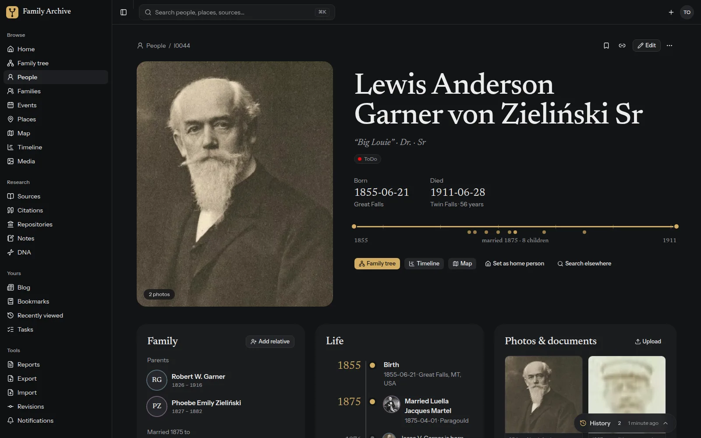
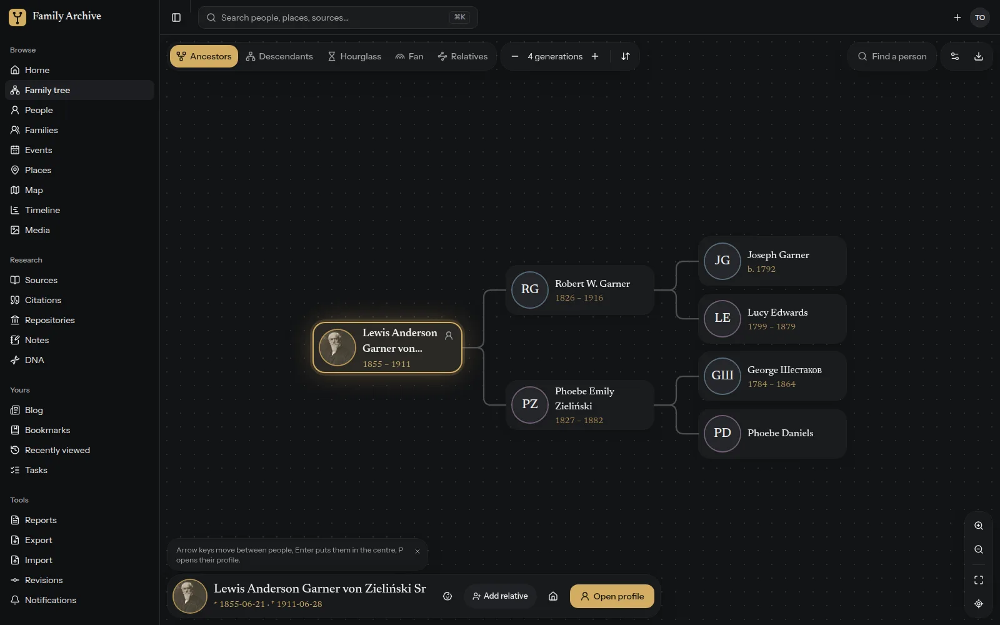
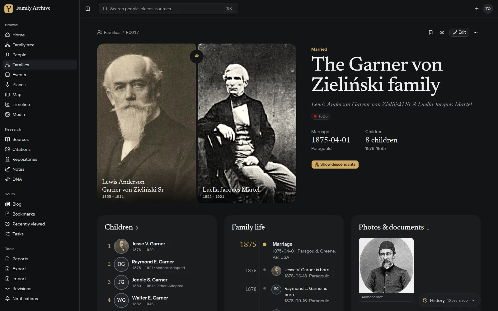
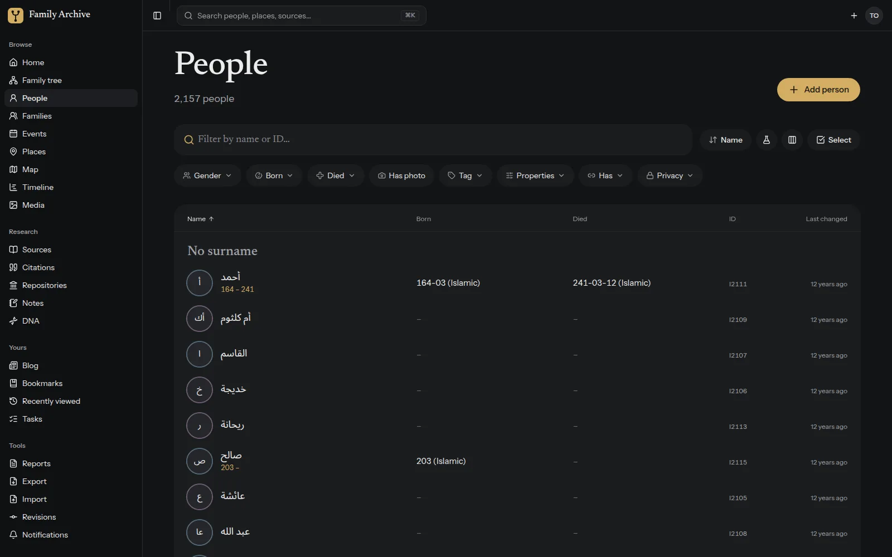
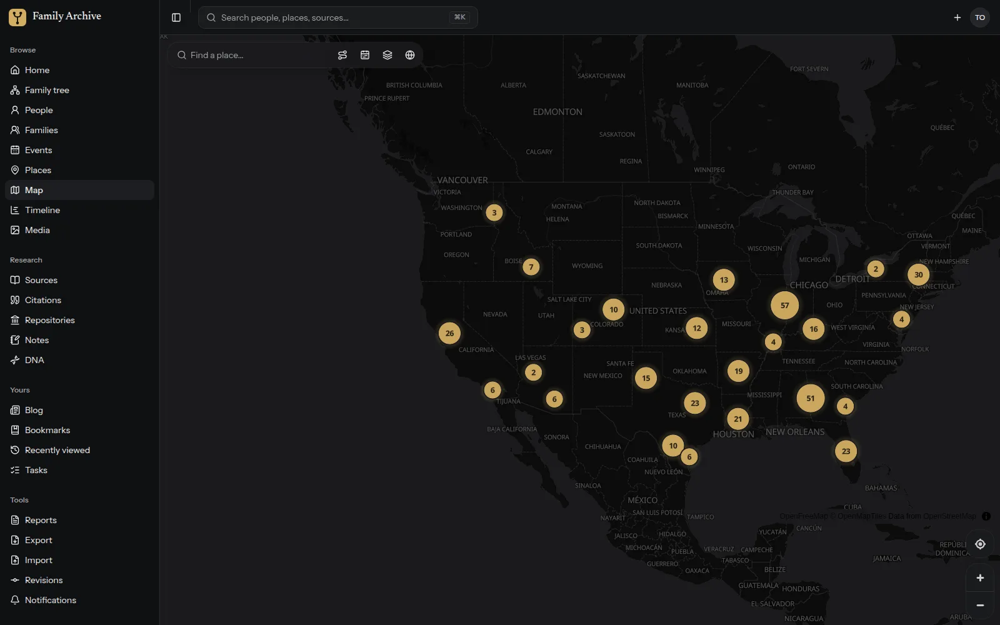
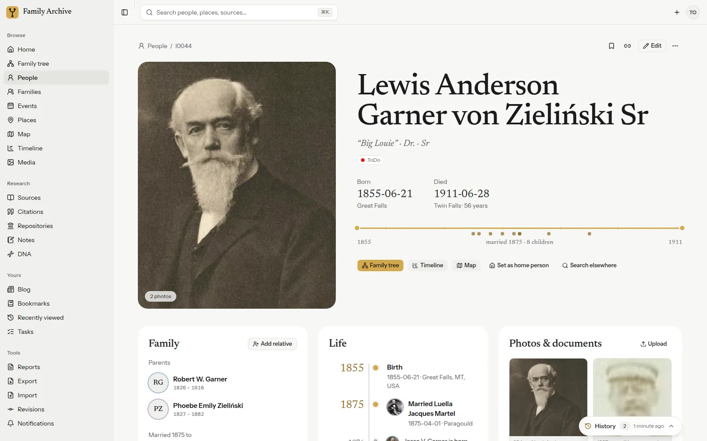
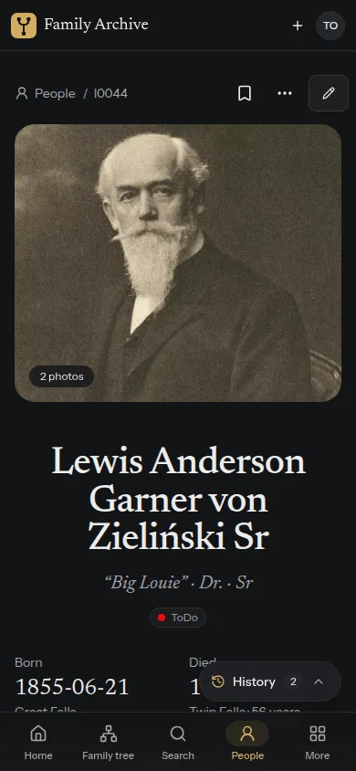

# Family Archive — a modern UI for Gramps Web

> [!IMPORTANT]
> **Early stage, community driven.** This project is not finished yet. You can test it today and it is designed to be
> fully compatible with Gramps Web, but there is no guarantee for that yet — please back up your data and report
> anything that doesn't work. Ideas, wishes and questions are very welcome: share them in
> [Discussions](https://github.com/b21-agency/gramps-ui/discussions), bugs go to
> [Issues](https://github.com/b21-agency/gramps-ui/issues).

A new, fast and friendly web interface for [Gramps Web](https://www.grampsweb.org/), the web version of the
genealogy software [Gramps](https://gramps-project.org/). It replaces only the user interface: your data,
users, permissions, search, media, reports and background jobs stay exactly as they are, served by the
unchanged Gramps Web API.



| | |
|---|---|
|  |  |
|  |  |
|  |  |

## Why

Gramps Web is a great backend with a capable but dated interface. This project keeps the backend and gives
it a UI that relatives of every age enjoy using:

- **People first** — large portraits, a life story told by years, families as faces.
- **Fast** — lists with thousands of people scroll instantly; data is cached and refreshed precisely after edits.
- **Uses your whole screen** — three-column layouts on wide monitors, one column on phones.
- **Made for phones too** — bottom tab bar, bottom sheets, swipeable photos; installable as an app.
- **Dark and light themes**, neutral by default, with a personal accent colour.
- **German and English.**

Everything Gramps Web can do is supported: people, families, events, places, sources, citations,
repositories, notes and media (with face regions and OCR); family tree charts (ancestors, descendants,
hourglass, fan, relationships); map with historic overlays; timeline; full-text search; blog; tasks;
bookmarks; change history with undo; reports, export and import; DNA matches; user management and tree
settings. See [docs/gramps-web-reference.md](docs/gramps-web-reference.md) for the full feature mapping.

## Get the new UI

There are two ways to run it next to your existing Gramps Web data. Both use the
[official docker-compose setup](https://www.grampsweb.org/install_setup/deployment/) as a starting point and
leave your data, users and configuration untouched.

| | Option 1: replace the classic UI | Option 2: additional service |
|---|---|---|
| Image | `ghcr.io/b21-agency/gramps-ui:latest` | `ghcr.io/b21-agency/gramps-ui:latest-proxy` |
| What changes | the image of `grampsweb` and `grampsweb_celery` | one new service in the stack |
| Classic UI | gone (back in one step) | keeps running on its own address |
| Good for | switching for good | trying it out, or offering both |

### Option 1: replace the classic UI

The image *is* the official Gramps Web image with this UI built in, so the API, the Celery worker, your volumes,
environment and ports stay exactly the same.

1. In your `docker-compose.yml`, replace the image of **both** `grampsweb` and `grampsweb_celery`:

   ```diff
    services:
      grampsweb:
   -    image: ghcr.io/gramps-project/grampsweb:latest
   +    image: ghcr.io/b21-agency/gramps-ui:latest
        ...
      grampsweb_celery:
   -    image: ghcr.io/gramps-project/grampsweb:latest
   +    image: ghcr.io/b21-agency/gramps-ui:latest
   ```

2. Pull and restart:

   ```sh
   docker compose pull
   docker compose up -d
   ```

3. Open Gramps Web at its usual address and sign in with your existing account.

**Going back:** change both images back to `ghcr.io/gramps-project/grampsweb:latest` and run
`docker compose up -d`. Switching never changes your data.

> Tip: back up your volumes (or use Gramps Web's export) before any upgrade — good practice, not a requirement.

### Option 2: additional service (classic UI stays)

A small nginx image that serves the new UI and forwards `/api/` to your existing `grampsweb` container. Add it
to the same compose stack, next to your existing services:

```yaml
services:
  # ... your existing grampsweb, grampsweb_celery and grampsweb_redis services ...
  ui:
    image: ghcr.io/b21-agency/gramps-ui:latest-proxy
    restart: always
    ports:
      - "8080:80"            # new UI on :8080, the classic UI stays on its usual port
    depends_on:
      - grampsweb
```

Then `docker compose up -d` and open port 8080 (or route a domain of its own to the `ui` service on port 80).
Both UIs share the same data and accounts.

Settings (all optional):

| Variable | Default | Meaning |
|---|---|---|
| `GRAMPSWEB_UPSTREAM` | `http://grampsweb:5000` | where the Gramps Web API is reachable from the `ui` container |
| `CLIENT_MAX_BODY_SIZE` | `1g` | largest upload (photos, imports) |

Health check: `GET /healthz` answers `ok`. To remove it again, delete the `ui` service and run
`docker compose up -d --remove-orphans`.

E-mail links (password reset, confirmation) point to pages the API serves itself, so they work with both options.

### Image tags

| Tag | What it is |
|---|---|
| `latest` | Option 1: official Gramps Web (latest) with the new UI |
| `<commit sha>` | The same, pinned to a specific build |
| `latest-proxy` | Option 2: nginx serving only the new UI, proxying `/api/` to an existing Gramps Web |
| `<commit sha>-proxy` | The same, pinned to a specific build |

## Development

Requirements: Node 22, pnpm, Docker.

```sh
pnpm install
docker compose -p gramps-dev -f dev/docker-compose.yml up -d   # local Gramps Web backend
./dev/seed.sh                                                  # first run: example tree + users
pnpm dev                                                       # http://localhost:5173
```

Test users: `owner`, `editor`, `guest` (password = user name). To develop against a real instance:
`GRAMPS_API_TARGET=https://your-gramps-web.example pnpm dev`.

Stack: React 19, TypeScript, Vite, Tailwind CSS 4, shadcn/ui, RTK Query (generated from the Gramps Web
OpenAPI spec: `pnpm api:fetch-spec && pnpm api:generate`), react-router, i18next, MapLibre.
Read [docs/ui-conventions.md](docs/ui-conventions.md) before contributing code.

Build the images locally:

```sh
docker build -t gramps-ui .                    # drop-in (default target)
docker build --target proxy -t gramps-ui:proxy .
```

## How you can help

This is a young project and every bit of help makes it better for families everywhere.

- **Try it and tell us what you think.** Switch your installation (it's reversible), use it with your
  family, and open an issue with anything that feels wrong, confusing or slow — screenshots help.
- **Report bugs** with steps to reproduce, your browser/device and your Gramps Web version.
- **Test on phones and tablets.** Real devices find problems no emulator does (keyboards in bottom sheets,
  notches, gestures, installing as an app).
- **Translate.** UI texts live in `src/locales/<area>.<lang>.ts`. Adding a language means copying the
  English files and translating them — no programming needed. Corrections to the German texts are welcome too.
- **Improve accessibility.** Screen-reader and keyboard users: tell us where it doesn't work for you.
- **Share your use case.** Large trees, unusual data, other cultures' naming and calendars — real-world
  data exposes the edge cases.
- **Contribute code.** Pick an issue, open a pull request, keep changes focused and follow the conventions.
- **Spread the word** — and star the repository if you like it.
- **Support Gramps itself.** This UI stands on the shoulders of the Gramps and Gramps Web projects;
  consider contributing to or donating to them as well.

## Relationship to Gramps Web

This is an independent, community frontend. It is not affiliated with or endorsed by the Gramps project.
It talks only to the public Gramps Web API and does not modify the backend. Many thanks to the Gramps and
Gramps Web developers for their excellent work.

## License

[GNU Affero General Public License v3.0 or later](LICENSE), the same license as Gramps Web. You may use,
change and share this software; if you run a modified version for others, you have to offer them its source code.
